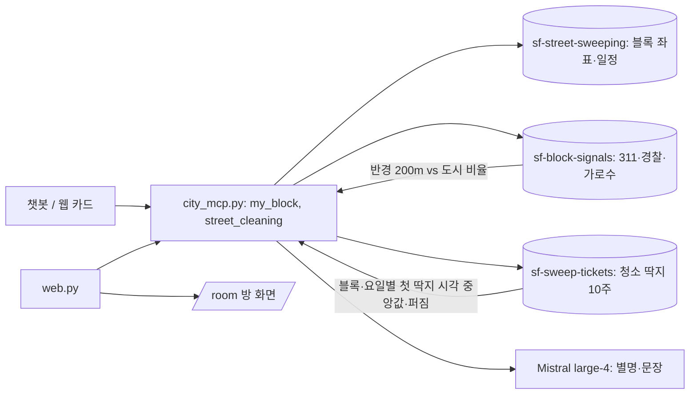

# SF City Memory + Your Block, Unfiltered

## 목표

팀원(David)의 SF City Memory MCP 서버에 "Your Block, Unfiltered"를 얹는다. 챗봇에게 "우리 블록 뭐가 이상해?"라고 물으면, 그 블록에만 유난히 있는 진짜 사실 3개와 블록 별명이 나온다. 그리고 "차 옮겨야 해?"라고 물으면 청소 일정과 함께 **단속원이 보통 오는 시각**까지 알려준다.

무대에서는 같은 결과를 Wrapped 카드로 보여주고, 방 화면에 "오늘 방에서 가장 이상한 블록"을 띄운다.

## 접근

- **기존 구조를 그대로 쓴다:** `sfhack.es` / `sfhack.mistral`, `mistral-large-4`(`reasoning_effort="low"`), Elasticsearch Serverless, 같은 코드 스타일(짧은 파이썬 파일).
- **새 적재 스크립트 `ingest_block.py`:** data.sf.gov에서 최근 2년 치를 인덱스 하나 `sf-block-signals`에 넣는다. 필드는 `dataset`, `category`, `location`(geo_point), `ts`.
  - 311 `vw6y-z8j6`: `service_subtype`
  - 경찰 `wg3w-h783`: `incident_description`. 무거운 범죄는 뺀다.
  - 가로수 `tkzw-k3nq`: 수종
- **새 적재 스크립트 `ingest_tickets.py`:** 주차 딱지 `ab4h-6ztd` 중 `STR CLEAN`을 최근 10주 치만 `sf-sweep-tickets`에 넣는다. 블록 키는 거리 이름 + 번지 백 단위, 그리고 요일과 시각이다.
- **새 MCP 도구 `my_block(street, cross_street)`:**
  - 위치는 기존 `sf-street-sweeping` 인덱스의 블록 좌표를 쓴다. 외부 지오코더가 필요 없다.
  - 반경 200m 안의 category 비율을 도시 전체 비율로 나눈다. Elastic `significant_terms`나 filter 집계를 쓴다.
  - 8배 이상이면서 15건 이상인 것 가운데 상위 3개를 고르고, Mistral이 별명과 문장을 쓴다. 숫자는 계산값만 쓴다.
- **`street_cleaning` 확장:** 블록마다 "officer usually by HH:MM (±N min, seen X of Y weeks)"를 붙인다. 4주 이상 관측되고 퍼짐이 10분 이하인 블록만이다.
- **웹 데모 `web.py`:** 같은 함수를 부르는 작은 웹 서버. `/`는 폰용 Wrapped 카드, `/room`은 방 화면(제출된 블록 지도와 상위 5개)이다.
- 작은 결정과 근거:
  - 시간이 빠듯해 플랜 리뷰는 생략했다.
  - 외부 지오코더 대신 기존 인덱스를 쓴다. 이미 있는 것을 쓰는 단순한 쪽이다.
  - 팀원 저장소에는 브랜치로 작업하고, 합칠 때는 팀원과 맞춘다.

## 아키텍처와 데이터 흐름

## 엣지 케이스

- **찾지 못한 거리:** 기존 `street_cleaning`처럼 "찾지 못함"을 돌려준다.
- **건수가 작은 블록:** 반경을 300m로 넓힌다. 그래도 없으면 "이 블록은 놀랍도록 평범하다" 카드를 보여준다.
- **기본 좌표로 몰린 지점:** 535 Folsom처럼 한 좌표에 비정상적으로 몰린 지점은 거른다.
- **범죄 사실:** 낙인이 될 수 있어 총기와 폭력은 빼고, 상점 절도 정도까지만 쓴다.
- **Mistral 무료 한도:** 429 응답이 오면 재시도하고, 계속 실패하면 템플릿 문장으로 대체한다.
- **딱지가 없던 주:** 데이터에 남지 않으므로 "seen X of Y weeks"로 정직하게 표시한다.

## 테스트 계획

- TP-1: `my_block("Mission St", "24th St")`를 부르면 사실 3개가 나오고, 그중 보도 판매 위반이 높은 배수로 포함된다.
- TP-2: `my_block("Chestnut St", "Fillmore St")`를 부르면 유흥 소음 민원이 상위 사실에 있다.
- TP-3: `street_cleaning("Guerrero St")`의 900 블록 목요일 결과에 "officer usually by 07:05" 근처 시각이 붙는다.
- TP-4: 없는 거리를 넣으면 오류 없이 "찾지 못함" 문장이 나온다.
- TP-5: Mistral 키가 없거나 429가 계속되면 템플릿 문장이 나오고, 도구가 죽지 않는다.
- TP-6: `web.py`에서 주소 5개를 제출하면 `/room`에 5개가 나타나고 상위 5개 순위가 갱신된다.

## 디자인 노트

## 위험

- 팀원 저장소 쓰기 권한이 아직 없어요(공개 저장소이고 push 권한 없음). 브랜치에서 작업하고, 팀원이 초대해 주면 push해요.
- Elastic Serverless와 Mistral 키는 팀원 `.env`에 있어요. 우리 쪽에서 돌리려면 키를 받아야 해요.
- 311 적재량: 2년 치만 넣어도 수백만 건이에요. 하위 분류와 좌표만 넣어서 가볍게 해요.

## 리뷰 노트
